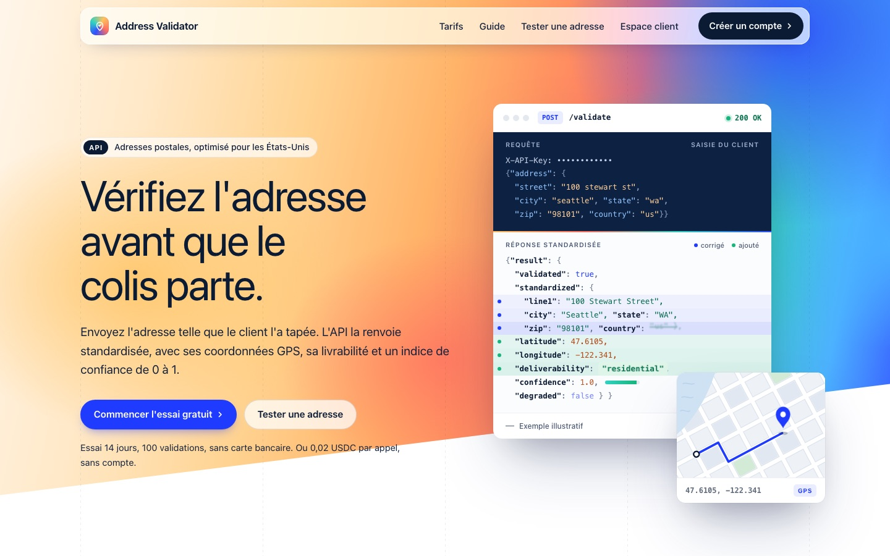

# Maquette : page d'accueil de kder-ai.com

**Proposition à valider. Rien dans `app/` ne change ici.** Aujourd'hui `GET /` renvoie du
JSON brut : une boutique qui tape `kder-ai.com` dans son navigateur tombe sur
`{"service":"Address Validator API",…}`. Cette maquette propose la vitrine qui la
remplacerait pour les navigateurs.

| Bureau (haut de page animé) | Téléphone |
|---|---|
|  |  |

Page complète au bureau : [capture-desktop.jpg](capture-desktop.jpg).

## Voir les animations

Télécharge `maquette-accueil.html`, ouvre-le dans **Chrome** ou un **Safari récent**,
recharge la page puis fais défiler lentement. Les liens (`/signup`, `/pricing`…) sont
relatifs : ils ne mènent nulle part en local, ils pointeront vers le site une fois
intégrés.

## Ce qui est respecté

- **Ta CSP actuelle** (`default-src 'none'; style-src 'unsafe-inline'`) : un seul fichier,
  aucun JavaScript, aucune police ni image externe. Les animations sont en CSS et en SVG
  inline.
- **Tout reste lisible sans animation** : avec `prefers-reduced-motion: reduce`, ou dans
  un navigateur sans `animation-timeline` (Firefox), la page s'affiche complète et immobile.
- **Le formulaire est le vrai** : `POST /validate-form` avec les 5 champs de `CHAMPS`
  (`street`, `city`, `state`, `zip`, `country`), dans le même ordre.
- **Rien d'inventé** : pas de témoignage, de logo client ou de chiffre de marché.
  L'exemple est une adresse américaine marquée « exemple illustratif ». Ses valeurs suivent
  `scorer.py` (`residential` avec GPS donne `1.0`). Le bloc « couverture » dit que la
  vérification est partielle hors US.
- **Vérifié par capture automatique** (Playwright) : aucune requête externe, aucune erreur
  de page, aucun débordement horizontal à 375 et 390 px.

## À décider avant l'intégration

1. **La direction visuelle** : une page claire, avec une bande de dégradé en biais qui bouge
   lentement et une carte « API » qui se remplit toute seule. Elle s'inspire de la
   grammaire de stripe.com, sans en copier ni le logo, ni les textes, ni les couleurs.
2. **La navigation** : la maquette a sa propre barre. D48 veut une seule navigation
   (`site_head()`). Deux options : garder `site_head()` sur l'accueil, ou passer plus tard
   toutes les pages publiques à ce nouveau style.
3. **L'accroche** : « Vérifiez l'adresse avant que le colis parte. »
4. **Les polices** : la maquette n'utilise que les polices système. Si tu acceptes
   `font-src 'self'`, on peut héberger une police sur le site.

## L'intégration proposée (autre branche, après ton accord)

- `GET /` sert cette page aux navigateurs (`Accept: text/html`) et garde **exactement** le
  JSON actuel pour les programmes. `tests/test_app_smoke.py`, `tests/test_pricing.py`,
  `scripts/e2e_check.py` et les portes qui lisent `/` en JSON continuent de passer.
- Les prix, l'essai gratuit, le prix x402 et le contact sont lus dans la configuration,
  comme sur `/pricing` (D43, D48) : aucun chiffre écrit en dur.
- Une décision D53, sa porte dans `decisions_check.py` et des tests, comme pour D51 et D52.
