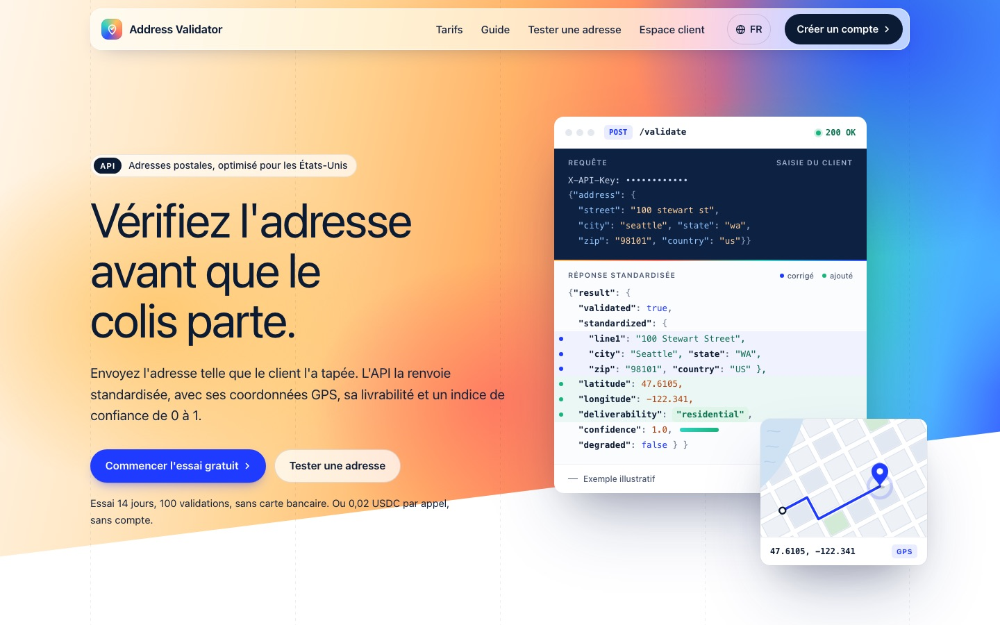
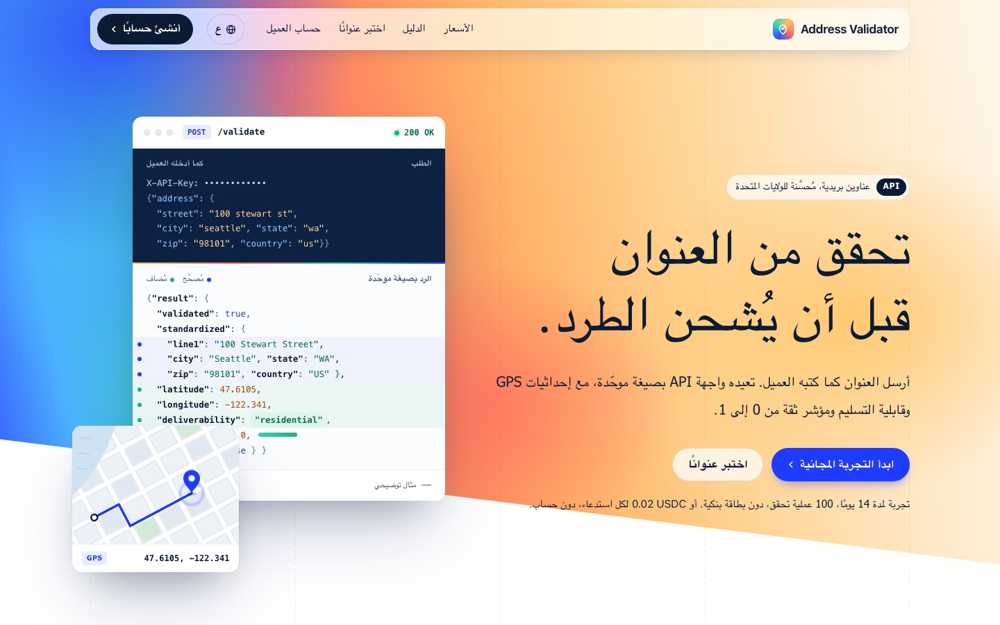
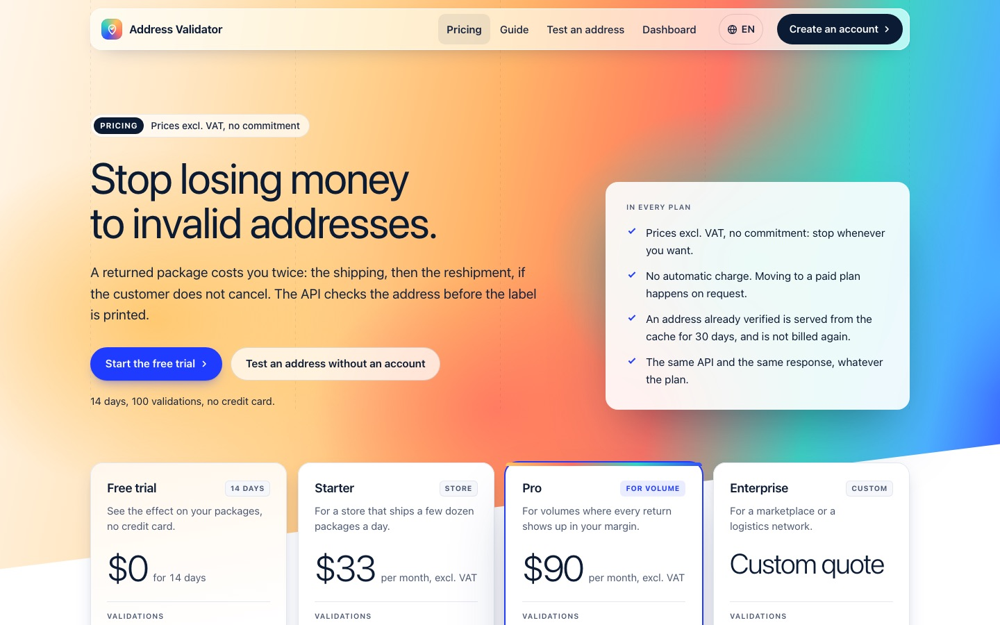
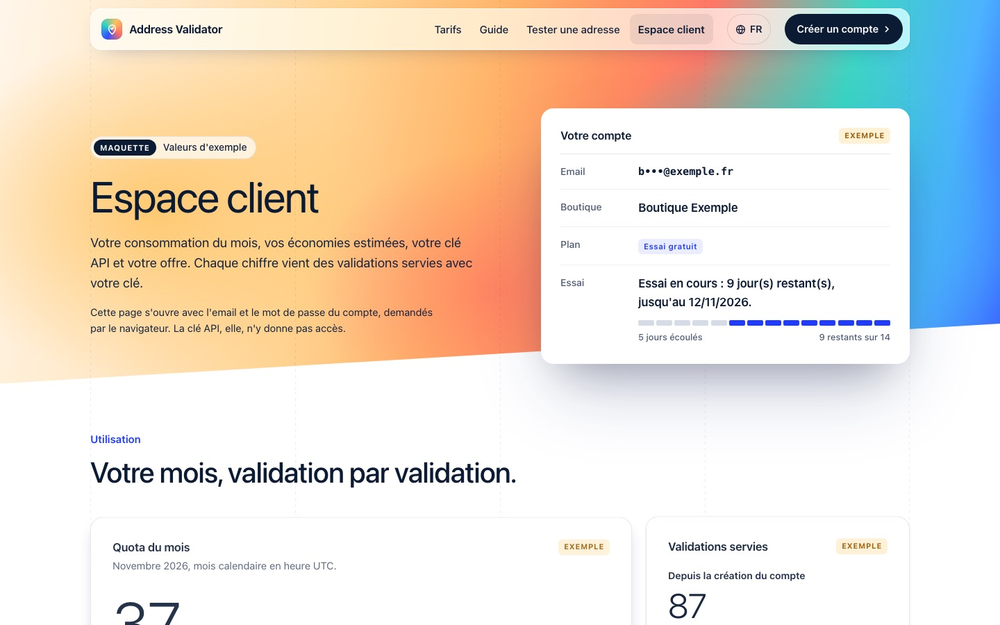

# Maquette : le site complet en 6 langues, avec photos

**Proposition à valider. Rien dans `app/` ne change ici.** C'est la suite de la page d'accueil
déjà intégrée (D53) : les 7 pages publiques dans le même style, en français, anglais, chinois,
hindi, espagnol et arabe (42 pages), avec 4 photos et les prix dans la monnaie de chaque langue.

| Accueil (FR) | Accueil (AR, droite à gauche) |
|---|---|
|  |  |
| **Tarifs (EN, en dollars)** | **Espace client (FR)** |
|  |  |

Autres aperçus : [guide](captures/guide-fr-hero-motion.jpg), [tester une adresse](captures/test-fr-hero-motion.jpg).

## Voir la maquette

Télécharge le dossier, ouvre `accueil-fr.html` dans Chrome ou un Safari récent. Le menu mène
aux autres pages, le bouton 🌐 change de langue sur chaque page. Fichiers : `<page>-<langue>.html`
avec `page` = `accueil`, `tarifs`, `test` (tester une adresse), `inscription`,
`inscription-cle` (clé affichée une fois), `guide`, `compte` (espace client) et `langue` =
`fr`, `en`, `zh`, `hi`, `es`, `ar`.

## Ce qui est respecté

- Même CSP qu'aujourd'hui pour tout le reste : aucun JavaScript, aucune police ni ressource
  externe, animations en CSS. Vérifié par capture automatique sur les 42 pages : aucune requête
  externe, aucune erreur, aucun débordement à 375 et 390 px.
- Formulaires réels (`/validate-form`, `/signup`, `/compte/cle`) avec les mêmes `name` que le
  code. Pas de champ `plan` à l'inscription (D54).
- Contenu repris du code (`pricing.py`, `validate_form.py`, `signup.py`, `guide.py`,
  `accounts.py`), sans témoignage, logo client ni chiffre inventé. Contact :
  `address-validator@kder-ai.com` (D55).

## À décider avant l'intégration

1. **Les photos.** 4 images générées par IA (commerçante, livraison, développeur, entrepôt),
   illustratives, jamais présentées comme des clients. Ta CSP actuelle interdit les images :
   il faudrait `img-src 'self'` et servir `images/` depuis l'application.
2. **Les corrections d'honnêteté de la page Tarifs** (détail en tête de `tarifs-fr.html`) :
   - plan Pro : « import CSV en masse », « webhooks Shopify / WooCommerce » et « réponse
     prioritaire » n'existent pas dans le service, remplacés par des promesses vraies ;
   - Enterprise : SLA, facturation annuelle, intégration accompagnée retirés (rien ne les porte) ;
   - « Le plus choisi » retiré (aucun client à ce jour) ;
   - FAQ « Couvrez-vous La Réunion ? » : l'ancienne réponse (« référentiel international »)
     était fausse, elle dit maintenant optimisé US, partiel ailleurs ;
   - « 22 % » et « 17 à 30 $ » gardés comme ordres de grandeur non sourcés : à sourcer ou retirer.
3. **Les prix par monnaie.** Les abonnements sont affichés convertis depuis l'euro (taux de
   septembre 2026), avec la mention « facturé en euros : 29 € et 79 € » : $33 / $90 (anglais,
   arabe), ¥223 / ¥608 (chinois), ₹3,160 / ₹8,620 (hindi), 29 € / 79 € (français, espagnol).
   Le coût d'un colis raté suit la même logique (15 €, $17, ¥115, ₹1,600). Aujourd'hui
   `accounts.COUT_ECHEC_USD` calcule en dollars : à adapter par langue.
4. **Les traductions** chinoise, hindi et arabe sont à faire relire par une personne qui parle
   ces langues avant la mise en ligne.
5. **Un défaut trouvé dans le code** : un résultat `degraded: true` sort avec
   `validated: false`, donc livrabilité `invalid` et confiance 0.05. Ça contredit le message
   « la réponse ne dit rien de l'adresse ». La maquette de « Tester une adresse » montre ces
   valeurs grisées ; à corriger dans `scorer.py` / `_resultat_html` (branche à part).
6. Petits ajouts proposés : la date de fin d'essai sur la page de la clé et dans l'espace client,
   un bandeau « fin d'essai proche », le vrai pluriel à la place de « jour(s) restant(s) ».

## L'intégration proposée (après ton accord, une branche par sujet)

1. Images : `img-src 'self'` et une route statique pour `images/`.
2. Langues : routes `/en/`, `/zh/`, `/hi/`, `/es/`, `/ar/` (le français reste à la racine),
   `hreflang`, page d'accueil.
3. Les 5 autres pages, une par une.
4. Prix par monnaie et corrections de la page Tarifs.
5. Correctif du résultat dégradé.
